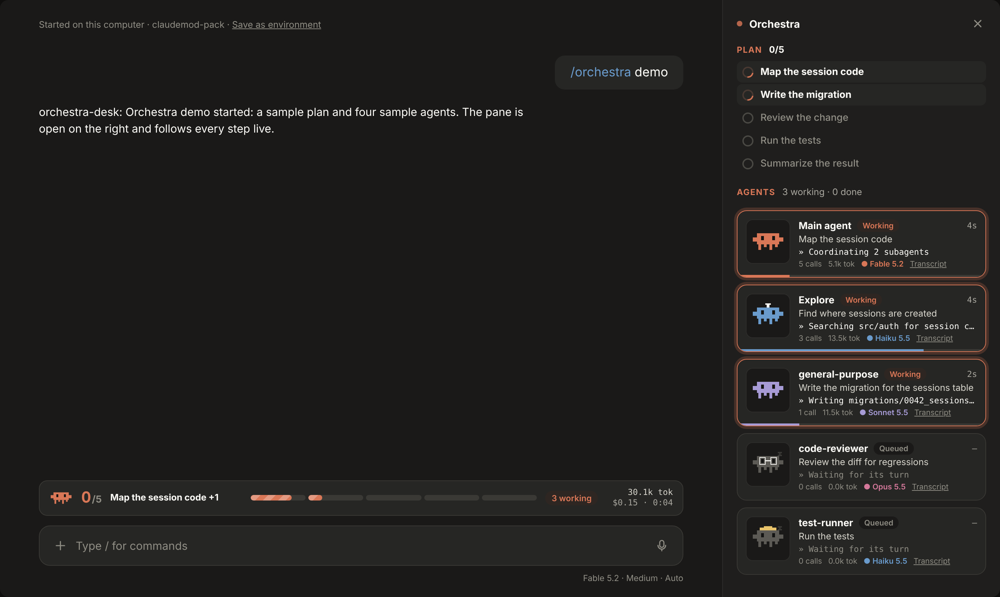
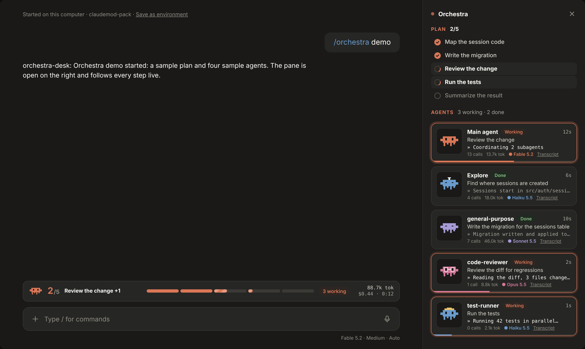
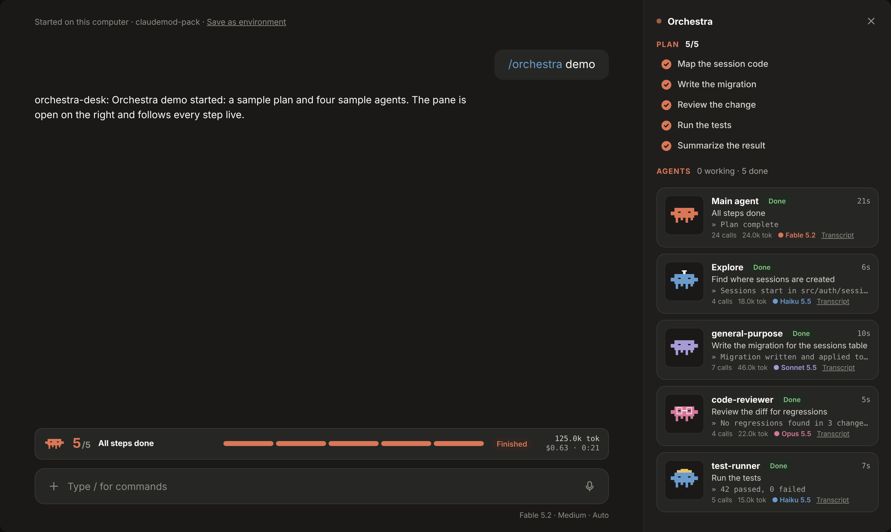
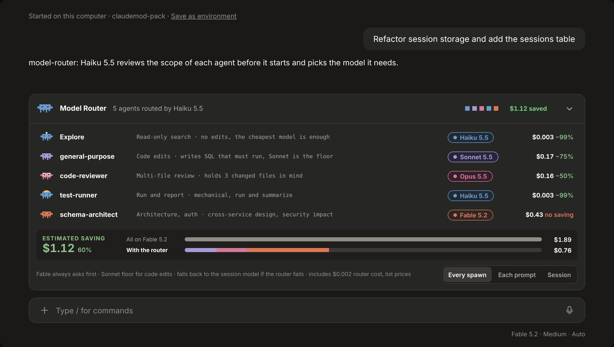
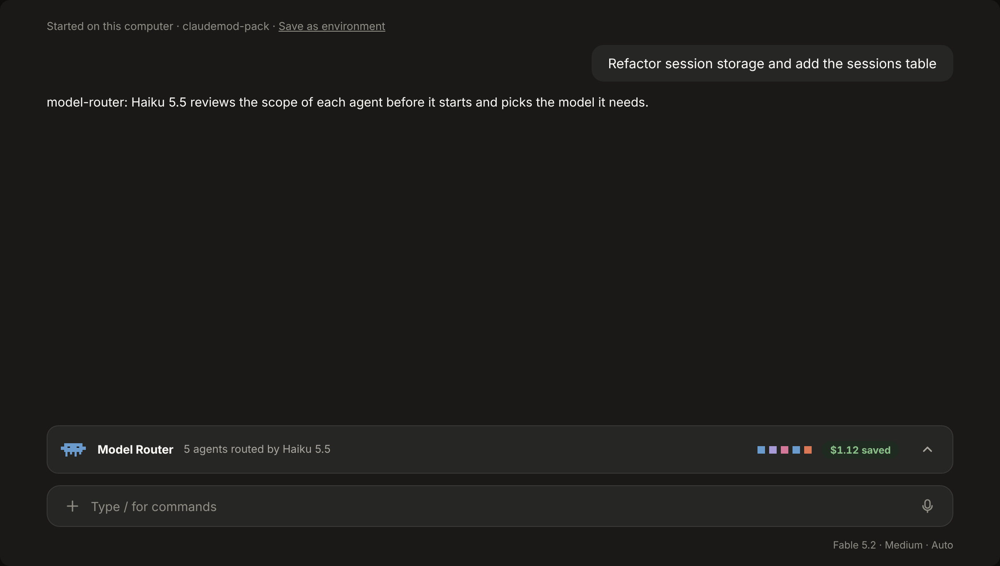

# claudemod-pack

A pack of [Claude Code mods](https://code.claude.com/docs/en/plugins/mods/overview.md), published as a plugin marketplace. Each mod is a Claude Code plugin with a hooks module: JavaScript/TypeScript that runs inside the session and can draw bands, panes and toasts, add commands and tools, and react to tool calls.

| Mod | Version | What it does |
| --- | --- | --- |
| [orchestra-desk](plugins/orchestra-desk) | 0.1.0 | A to-do progress band above the prompt and a side pane with a live card per subagent. |
| [model-router](plugins/model-router) | 0.1.0 | Haiku picks a model for each subagent before it starts (agent A on Sonnet, agent B on Opus), warns before Fable, and `/router` shows the estimated saving. |

---

## Preview

Design reference images (dark theme). The terminal band follows these; surface fills and animations are approximated.

**orchestra-desk**





**model-router**




---

## Install

You need **Claude Code 2.1.287+** in the terminal, or **2.1.286+** in the Desktop app's Code tab. In the terminal, check with `claude --version` and update with `claude update`. In the Desktop Code tab, run `/status`. Mods do not run in claude.ai chat, in cloud sessions, or in Desktop sessions under WSL.

### From GitHub

At the Claude Code prompt (terminal or Desktop Code tab):

```
/plugin marketplace add minhtanpham/claudemod-pack
/plugin install <mod>@claudemod-pack
/reload-plugins
```

`/reload-plugins` is only needed in chats that were already open.

### From a local clone

```bash
git clone https://github.com/minhtanpham/claudemod-pack.git ~/projects/claudemod-pack
```

```
/plugin marketplace add ~/projects/claudemod-pack
/plugin install <mod>@claudemod-pack
```

### Update, disable, uninstall

```
/plugin marketplace update claudemod-pack   # pull the newest versions
/reload-plugins

/plugin disable <mod>@claudemod-pack        # keep it installed, turn it off
/plugin uninstall <mod>@claudemod-pack
/plugin marketplace remove claudemod-pack   # forget the whole pack
```

The same actions are available from your shell as `claude plugin ...`.

---

## Development

### Repository layout

```
claudemod-pack/
├── .claude-plugin/
│   └── marketplace.json        # the catalog: one entry per mod, with its source folder and version
├── scripts/
│   └── dev.sh                  # link / unlink / status / test / watch / check
└── plugins/
    └── <mod>/                  # one folder per mod
        ├── .claude-plugin/
        │   └── plugin.json     # manifest: name, version, description
        ├── hooks/
        │   ├── hooks.json      # { "modules": ["./register.ts"] }  ← this key makes the plugin a mod
        │   └── register.ts     # the hooks module: exports register(on)
        ├── tests/
        │   └── <mod>.test.ts   # run by `claude plugin test`
        └── types/
            └── index.d.ts      # optional: types for the mod's own $.state / store values
```

### Anatomy of a mod

A mod needs three things ([Create a mod](https://code.claude.com/docs/en/plugins/mods/create.md)):

1. **`.claude-plugin/plugin.json`**: the plugin manifest. Mods add no required fields.
2. **`hooks/hooks.json`**: a `modules` array with one path, relative to this file, to the hooks module.
3. **The hooks module** (`.js`, `.ts`, `.tsx`, ...), an ES module that exports `register(on, options)`. Claude Code calls `register` once when the mod loads. Each `on(event, [filter], handler)` call adds a hook. A handler receives `($, e, next)`:
   - `$` is the mods API (`$.ui`, `$.store`, `$.fs`, `$.clock`, `$.agent`, `$.process`, ...).
   - `e` is the event.
   - `next(e)` passes the event on to the next mod / Claude Code. Mods form a middleware chain.

Common events: `session.start`, `tool.call`, `agent.spawn`, `command.run`, and `ui.render` (for example `component: 'AbovePrompt'` for a band, `component: 'Pane'` for a side pane). See the [mods reference](https://code.claude.com/docs/en/plugins/mods/reference.md) for every event and render site.

No Node.js install, bundler or build step is needed: Claude Code loads `.js`/`.ts`/`.tsx` directly.

### Development flow

Nothing below calls a model, except the one real run before a release.

| Step | Where | Command | Cost |
| --- | --- | --- | --- |
| 0. Link the pack, once | shell | `scripts/dev.sh link` | free |
| 1. Logic | shell | `scripts/dev.sh watch <mod>` | no session, no tokens |
| 2. UI, live | terminal and Desktop | the mod's demo command, e.g. `/orchestra demo` | no tokens |
| 3. Manifest and types | shell | `scripts/dev.sh check <mod>` | free |
| 4. Real events | any session | one real prompt | tokens; once per release |

#### 0. Link the pack (once)

```bash
scripts/dev.sh link
```

This adds `plugins/` to `CLAUDE_CODE_PLUGIN_DIRS` in the `env` block of `~/.claude/settings.json` (a copy of the file is kept beside it as `settings.json.before-dev-link`). Every session started afterwards, in the terminal or by the Desktop app, loads every mod in this folder straight from the working tree and reloads it on save. A slash command that answers `Unknown command` means the session does not have the mod: it was started before the link, so open a new one.

`scripts/dev.sh status` shows the link and `scripts/dev.sh unlink` removes it. Unlink when you are not developing, since linked mods run in all your sessions.

#### The demo command (every mod has one)

Only the engine sends `tool.call`, `agent.spawn` and `turn.complete`, and only a mod itself can write its own `$.state`, so no outside tool can feed a running mod made-up events. Each mod therefore carries its own demo: a slash command, answered by a `command.run` hook without `next`, that writes sample values through the same atoms the real hooks write. It runs locally and calls no model.

| Mod | Command | Shows |
| --- | --- | --- |
| `orchestra-desk` | `/orchestra demo`, `/orchestra clear` | a 4-step plan and three subagent cards, about 16 seconds |

To check from a shell that the engine loads a mod and runs its command, with no login and no model call:

```bash
claude --plugin-dir ./plugins/<mod> --debug-file /tmp/mod.log -p "/<command> demo" < /dev/null
```

#### 1. Unit tests (no session, no tokens)

```bash
cd plugins/<mod>
claude plugin test
```

`claude plugin test` runs every `*.test.ts` / `*.test.tsx` file in the plugin folder. Tests import the kit from `claude-code/testing` and run without a session, sign-in, network or model calls. The command exits 1 on failure, so it works in CI.

```ts
import { expect, mock, test } from 'claude-code/testing'

test('a TodoWrite call updates the band', async ($, on) => {
  // 1. Register stubs first: they answer in Claude Code's place
  on('session.start', () => ({ cwd: '/work' }))
  on('command.register', () => ({ value: undefined }))
  on('tool.call', () => ({ result: 'ok' }))
  const clock = mock.clock(on)          // timers you advance by hand

  // 2. Raise events through the mod's hooks
  await $.session.start({ surface: 'terminal', isInteractive: true, cwd: '/work' })
  await $.tool.call({ tool: 'TodoWrite', todos: [/* ... */] })
  await clock.advance(1000)

  // 3. Draw a render site and inspect / press it
  const ui = await $.ui.mount({ plugin: '<mod>', component: 'AbovePrompt', surface: 'terminal' /* , props */ })
  expect(await ui.find({ type: 'Text', text: /2 of 4/ })).toBeDefined()
})
```

Rules from [Test a mod](https://code.claude.com/docs/en/plugins/mods/test.md):
- Every mods API call your mod makes needs a stub (`no implementation for X` means one is missing). Stubs for API calls return `{ value }`; stubs for events return the event's result.
- Register all stubs before the first call on `$`.
- `session.start` does not run by itself; raise it when your hooks depend on it.
- Use `surface: 'terminal'` and `surface: 'desktop'` in `$.ui.mount` to cover both apps.
- A drawing test checks the element tree, not the painted pixels. Check new layouts in a real session too.

Tip: keep SVG/layout builders as pure functions (data in, SVG string out). A test or a small script can then render every state to an HTML file, so you can iterate on visuals in a browser without a session.

#### 2. Live UI in the terminal (hot reload)

```bash
claude --plugin-dir ./plugins/<mod>
```

Claude Code watches a folder loaded with `--plugin-dir` and **hot-reloads the hooks module on every save**, so changes show up in the running session without a restart. Each reload runs `register` again, so in-memory state resets.

If the same mod is also installed from the marketplace, the `--plugin-dir` copy takes precedence for that session. You don't need to uninstall it.

To see the UI without a prompt, run the mod's demo command. The real events need one real prompt; keep it for last, on `/model haiku`: *"make a 4-step dummy to-do list, then run 2 Explore subagents that read README.md"*.

#### 3. Validate

```bash
claude plugin validate ./plugins/<mod>
claude plugin validate .        # the marketplace
```

An `ICON_MISSING` warning is expected; it only matters for submitting to Anthropic's directory.

#### 4. Check in the Desktop app (Code tab)

While developing, `scripts/dev.sh link` is enough: a new Desktop session loads the working tree. To check the mod as users get it, install it from the local clone as a marketplace:

```
/plugin marketplace add ~/projects/claudemod-pack
/plugin install <mod>@claudemod-pack
```

Installed plugins are cached by version. To see an edit in Desktop:

1. Bump `version` in **both** `plugins/<mod>/.claude-plugin/plugin.json` and the mod's entry in `marketplace.json`.
2. Run `/plugin marketplace update claudemod-pack`.
3. Run `/reload-plugins`.

Desktop draws mod UI except terminal-only elements, so check that the band and pane look right in both apps.

### Debugging

- **Log to a file:** write errors to `~/.claude/mods-logs/<mod>.log` (inside `$CLAUDE_CONFIG_DIR` if set) through `$.fs`, wrapped in `try/catch` so logging never breaks the session. Run `tail -f ~/.claude/mods-logs/<mod>.log` while you work.
- **Is it loaded?** Run `/plugin`, Tab to **Installed**, and look for the mod.
- **Does nothing in a session?** See [Troubleshoot a mod](https://code.claude.com/docs/en/plugins/mods/troubleshoot.md) and [Troubleshoot plugins](https://code.claude.com/docs/en/plugins/troubleshooting.md).

### Adding a new mod

1. Create `plugins/<mod>/` with `.claude-plugin/plugin.json`, `hooks/hooks.json` and `hooks/register.ts`. You can also ask Claude Code in a terminal or Desktop Code session (*"make a mod that ..."*) to scaffold, load and test it.
2. Go through the development flow above.
3. Add an entry to `.claude-plugin/marketplace.json` (`name`, `source: "./plugins/<mod>"`, `description`, `version`).
4. Add a row to the table at the top of this README.

### Releasing

1. Bump `version` in **both** `plugin.json` and `marketplace.json` (semver).
2. Run `claude plugin validate` and `claude plugin test` for each changed mod.
3. Commit and push. Users get it with `/plugin marketplace update claudemod-pack` and `/reload-plugins`.

All code in this repo is original. Ideas from other mods are fine; copying their code, assets or wording is not.

---

## Claude Code docs

- Mods: [Overview](https://code.claude.com/docs/en/plugins/mods/overview.md) · [Create](https://code.claude.com/docs/en/plugins/mods/create.md) · [Test](https://code.claude.com/docs/en/plugins/mods/test.md) · [Reference (events, API, render sites)](https://code.claude.com/docs/en/plugins/mods/reference.md) · [Troubleshoot](https://code.claude.com/docs/en/plugins/mods/troubleshoot.md)
- Plugins: [Overview](https://code.claude.com/docs/en/plugins.md) · [Create a plugin](https://code.claude.com/docs/en/plugins/create.md) · [Manifest reference](https://code.claude.com/docs/en/plugins/manifest-reference.md) · [Install and manage](https://code.claude.com/docs/en/plugins/install.md) · [Security and trust](https://code.claude.com/docs/en/plugins/security.md)
- Marketplaces: [Create a marketplace](https://code.claude.com/docs/en/plugins/create-marketplace.md) · [Host and maintain](https://code.claude.com/docs/en/plugins/host-marketplace.md) · [Publish and distribute](https://code.claude.com/docs/en/plugins/publish.md)
- Full docs index: <https://code.claude.com/docs/llms.txt>
