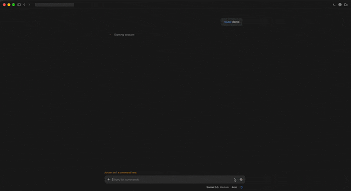

# subagent-router

Before each subagent starts, **Haiku 5.5** reads its type, title and prompt and answers `{model, scope, why, edits}`: the model for *that agent* (haiku, sonnet, opus or fable), a short scope ("Read-only search", "Code edits") and a one-line reason. Two agents of one session can get different models. The mod does this in an `agent.spawn` hook, which Claude Code's subagent docs describe as replacing the per-invocation `model` parameter.

- **Sonnet floor.** An agent that edits code never runs below Sonnet.
- **Fable always asks first.** Fable is the one pick that may go above the session model, but only with your OK, under a **Fable needed** chip: *<agent> <why>. Haiku picked Fable 5.2 $0.43. Opus 5.5 would cost $0.22.*, answered **Use Fable 5.2**, **Use Opus 5.5 instead** or **Cancel this agent** (the spawn is denied and the row struck out). Esc cancels the agent too. With nobody to ask (`-p`), it uses Opus. `allowFable: false` stops Haiku picking Fable at all.
- **No guessing.** If Haiku times out or answers badly, the agent keeps the session model. The mod never blocks a spawn.
- **The band** above the prompt. On desktop, VS Code and mobile: a header (mascot, status, one pip per agent, the saving), up to five rows (agent, reason, model chip, price and saving; queued, reviewing, waiting for OK and cancelled each look different), a saving strip (*All on <session model>* vs *With the router*) and a footer with the review switch. In the terminal it follows `design/cli`: a rule (clay while Fable waits for your OK), one header line (*Subagent Router · N routed · $X saved ▾*), one line per agent (mark, name, model, scope, price, `−N%`, or *needs OK*), *Fable-only $A → router $B · saved $C (N%)* and a footer whose first word is the review mode (press it to switch). The Fable question is drawn under a clay *── Fable needed ──* rule. `▾` collapses the band to its header. On a narrow band the reason column goes first.
- **Review switch:** *Every spawn* (Haiku reads each agent), *Each prompt* or *Session* (one decision per agent type, kept for the prompt or the session).
- **`/router`**: `status` (default), `demo` (plays a sample with no model call, ending at the Fable question), `mode save|strong|cap` (Usage mode), `mode spawn|prompt|session` (review), `off` / `on`, `reset`. The status line reads *subagent-router · \~$X saved (N%)*, or *subagent-router · waiting for your OK* while Fable waits.
- **Usage mode** (the *Mode* chip in the band): **Cap** (default) never goes above the session's model; **Save** lets Haiku pick the cheapest model that fits, up to `ceiling`; **Strong** bumps each pick one tier up (code edits at least Opus, reviewers to Fable, which asks first).
- **Band:** one row, `● Router  5 routed  ~$1.12 saved · 60%  Mode: Save  [▾]`. The chevron opens an inline block: a Save | Strong | Cap switch with a one-line description, then rows grouped by model (cost, delta; `needs OK` in clay while a Fable question waits). Never one row per agent. Narrow bands show only `$1.12`.
- **Options:** `ceiling` (`opus` default for Save and Strong; Cap always means never above the spawning session's model; `sonnet` or `opus` let Haiku upgrade an agent past it, which can cost more than not routing), `respectExplicit`, `allowFable` (default on), `showNotice`.

Not covered: the main session's own model, forks (they inherit the parent's), and a session that sets `CLAUDE_CODE_SUBAGENT_MODEL_FORCE`, which outranks the hook.

## Shared with Orchestra Desk

Model Router publishes a read-only `summary` (`{ plugin: 'subagent-router', key: 'summary' }`: routed count, saved amount, mode, per-model groups, Fable waiting). When Orchestra Desk (`agent-deck`) is installed it reads it and draws the router cluster in its one-row dock and a Router section in its pane, so only one saved amount shows. Only the owner writes state, so the mode is changed in Router's inline block. Both mods colour a model the same way through theme keys: Haiku `ide`, Sonnet `merged`, Opus `planMode`, Fable `claude`.

## Estimated saving

Two behaviours: **saving** (the default) never goes above the session model, so routing can only cut cost; **upgrade** (opt in with `ceiling: "opus"`) lets a hard agent run on a bigger model than the session, which can cost more and is shown as such.

Prices (per MTok, in / out): Haiku 5.5 $0.10 / $0.50, Sonnet 5.5 $2 / $10, Opus 5.5 $4 / $20, Fable 5.2 $8 / $40 (platform.claude.com pricing, 2026-11-16). Estimates split an agent's tokens 80% in / 20% out, from a size per role (explore 18k, coder 46k, reviewer 22k, tester 15k, other 30k, plus the prompt). Each Haiku review is about 2k tokens, $0.00036, and is counted in the total. Amounts under a cent show three decimals.

The demo's five agents in a Fable session: $1.89 all on Fable, $0.76 with the router (Haiku, Sonnet, Opus, Haiku, and Fable confirmed for the last), so \~$1.12 saved (60%). While Fable waits for your OK that agent is in neither total, so the band reads "so far": \~$1.12 saved (77%) of $1.45. Choosing Opus for the last instead gives $0.55 ($1.34, 71%). Cancelled agents are left out. If the router picks a dearer model than the session's (only with `ceiling` set to `opus` or `sonnet`), the band shows the real loss in clay: *costs \~$X more (+N%)*. The tally uses each agent's real token counts once it finishes. It is an estimate: it assumes the same tokens on the session model and ignores retries a cheaper model may need. Update `PRICE` in `hooks/router.ts` when prices change.
